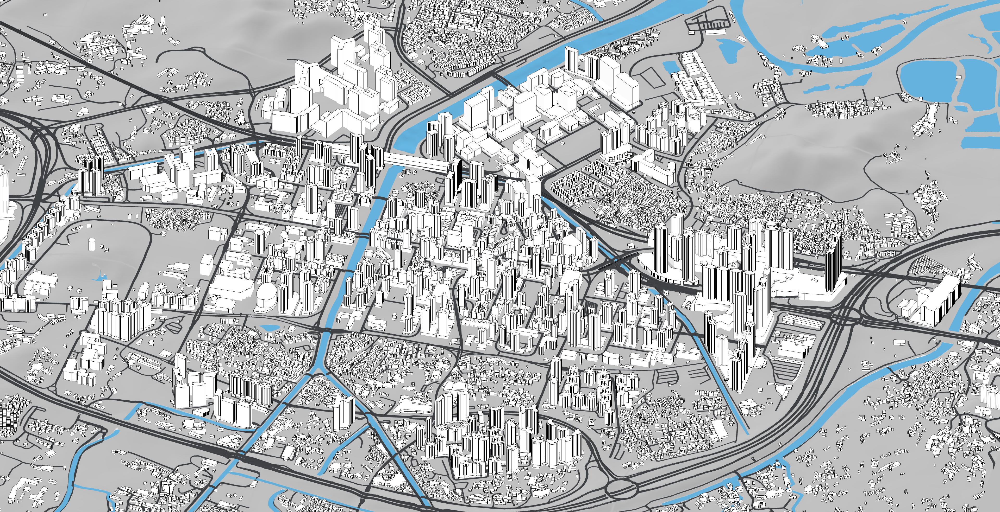
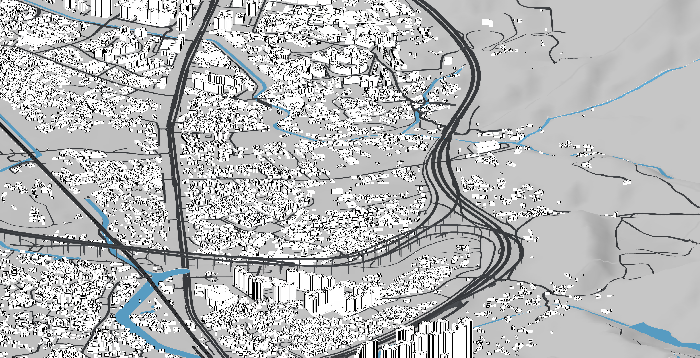
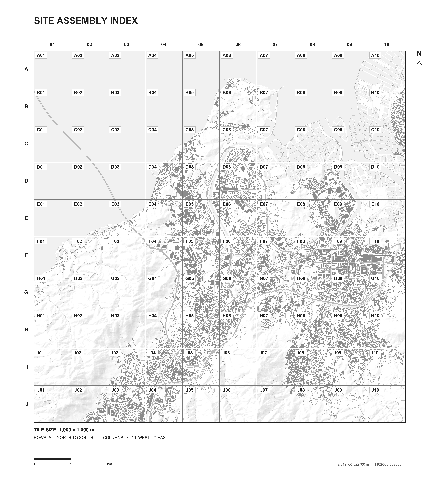
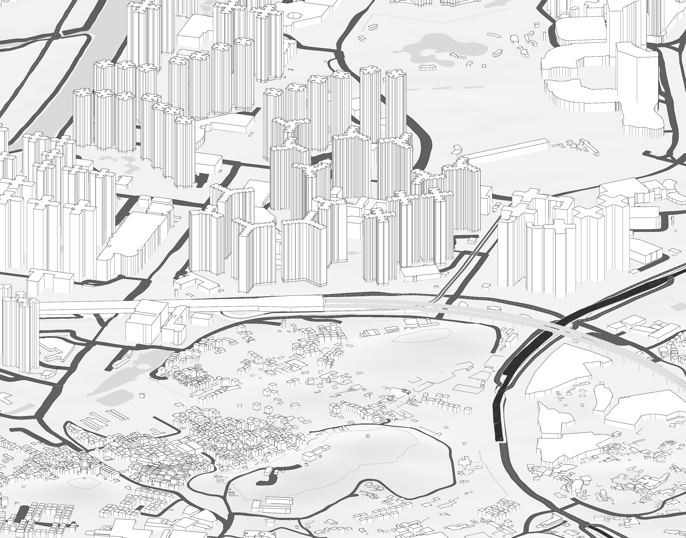

# 香港西北部城市与场地研究

**Ewan · GIS 分析、城市形态与 Rhino 场地建模**  
进行中的项目 · 公开快照：2026 年 10 月 14 日

[English](README.md) · [模型与预览](docs/model-and-preview.md) · [性能记录](docs/model-performance.md) · [城市肌理分析](docs/urban-tissue.md) · [建筑高度](docs/building-heights.md) · [地形与交通](docs/terrain-and-transport.md) · [核验记录](docs/validation.md)

项目在统一的 **10 × 10 km** 场地边界内，连接历史地图、建筑高度、地形和交通系统。地理信息系统（GIS）资料与 Rhino 模型使用共同的空间框架。文档区分来源事实、分析判断与几何估计。

最终本地交付包含 **67,196 个对象的总模型，以及 100 个 1 × 1 km 分块**。模型保留黑色建筑属性、灰色地形、白色基底和蓝色水面。2026 年 10 月 9 日的哈希复核确认，101 份模型均与最终核验记录一致。

*2026 年 10 月 14 日，在本机 Rhino 8.6 图形界面中，以 Line drawing style 显示模式和原生 ViewCaptureToFile 导出。分辨率为 3840 × 1968，未向源模型保存修改。此图展示局部城区，不代表完整场地边界。*

## 本次展示内容

| 范围或阶段 | 工作与成果 |
|---|---|
| 空间框架 | 100 km²。EPSG:2326 来源坐标。米制原尺寸。不作垂直夸张 |
| 最终模型 | 总模型 67,196 个对象。100 个一公里分块。最终集合共 101 份模型文件 |
| 分块拼接 | A–J 行由北向南，01–10 列由西向东。保留原世界坐标 |
| 项目预览 | Line Drawing 与 Blue Water Preview 模式。灰色地形与黑色建筑对象属性 |
| 城市肌理 | 四组固定 800 × 800 m 样区，对照约 1999–2000 年历史图与 2026 年编制资料 |
| 建筑高度 | 9 月 21 日阶段为 4,511 个建筑／构筑物源部件补充高度表达 |
| 早期交通检查 | 早期整合阶段记录 21 处铁路模块跨越、45 处铁路与地面道路检查及 86 项闭合桥面检查 |
| 公开内容 | 图片、方法、来源说明与经过筛选的本地核验摘要 |

各数值属于对应阶段和检查范围。源部件数量不等于独立建筑栋数。分块对象合计 67,177 个。另有 19 个超出分块索引范围的对象保留在总模型中。10 月更新没有重跑上述历史交通检查。几何检查通过也不等于实测精度或工程安全结论。

## 阅读路径

1. [城市肌理](docs/urban-tissue.md)：比较形成、延续和内部变化。历史资料缺失不能解释为没有建设。
2. [建筑高度](docs/building-heights.md)：区分官方属性、历史 LiDAR 和估计值。缺少依据的轮廓不任意赋高。
3. [地形与交通](docs/terrain-and-transport.md)：阅读海岸、地形、道路、桥梁及铁路关系，保留未解决的高度问题。
4. [模型与预览](docs/model-and-preview.md)：查看分块规则、显示设置与几何核验。
5. [性能记录](docs/model-performance.md)：查看最终模型与早期版本的实测差异及测试局限。
6. [核验记录](docs/validation.md)：区分最终阶段检查、历史记录和 10 月 9 日文件身份复核。

*2026 年 10 月 14 日，在本机 Rhino 8.6 图形界面中，以 Line drawing style 和原生 ViewCaptureToFile 导出 3840 × 1968 图片。未向源模型保存修改。此展示视图不是性能样本。*

*D05 的 Rhino 原生功能检查。1,274 个建筑对象属性为黑色，灯光仍能使部分面呈灰色。此图不是性能样本。*

*生成的分块索引图，不是 Rhino 原生截图。*

[10 月 9 日原生展示视图](docs/model-and-preview.md#native-presentation-captures) · [10 月 8 日受控 Shaded 基准记录](docs/model-performance.md)

## 早期研究阶段

*早期交通整合阶段的 Rhino 原生截图。新增立体轮廓和支撑含模型估计。*

*早期高度补充阶段的数据生成对照，使用相同相机和地面几何。示例范围包含 180 个新增高度部件。此图不是 Rhino 截图。*

[早期总览轴测图](images/site-global-axon.png) · [早期平面图](images/site-global-plan.png) · [完整图片目录](images/README.md)

## 项目与贡献说明

Ewan 提供项目需求、源资料和修订方向。脚本用于数据处理、模型整合、几何检查和导出。来源、估计和复核层分别记录证据。共享资料、政府地图及第三方数据保留原有署名，详见 [SOURCES.md](SOURCES.md)。本项目不将这些输入归为个人独立创作，也不声称独立手工完成全部建模。

最终 101 份模型均通过官方 openNURBS 7 读取内核检查。原生重开与显示检查使用 Rhino 8，未测试 Rhino 7 桌面版。10 月 9 日哈希复核没有重跑几何和性能检查。10 月 14 日仅新增展示截图。

## 如何理解证据

仓库发布视觉案例研究。原生模型、ZIP 包、计算机辅助设计（CAD）文件与 GIS 几何保留在本地。原始数据、依赖本机环境的脚本和完整工作日志也不公开。摘要不包含本机路径或个人标识，公开署名为 **Ewan**。

官方资料主要支持平面位置与来源关系。轨面、桥面、梁厚、柱跨和坡道高度含模型估计，不等于实测高程或施工设计。青田路边界桥采用 20.5 m 示意桥面。附近 15 m 官方高程点缺少明确的地面／桥面关联，两者关系仍未解决。天水围站下地面及概括站体也有局限。详见[地形与交通的局限](docs/terrain-and-transport.md#known-limitations)。

- [模型与预览说明](docs/model-and-preview.md)
- [性能条件与结果](docs/model-performance.md)
- [核验叙述](docs/validation.md)
- [结构化核验摘要](evidence/summary.json)
- [图片来源与哈希](evidence/image-manifest.json)
- [来源、署名与使用范围](SOURCES.md)
