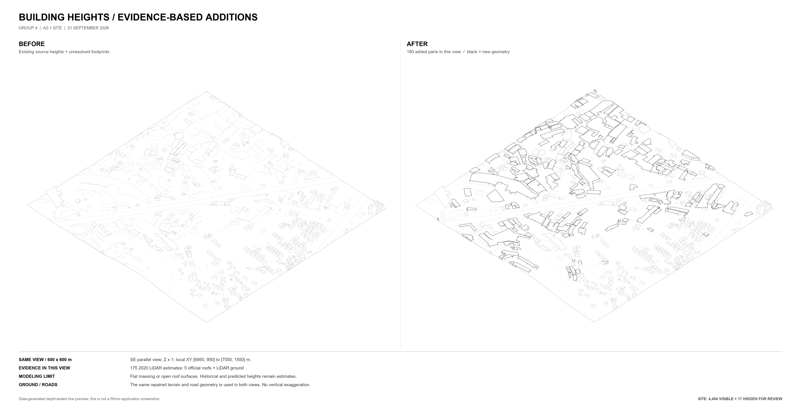

# Building heights with explicit evidence classes

[Back to the project](../README.md)

The 21 September height stage started with **23,625 source parts without usable heights**. It added height representation to 4,511 parts. The remaining 19,114 parts kept their footprints. These counts describe that stage, not individual buildings in the latest model.

*The same 600 × 600 m window, camera and ground geometry. Black additions mark 180 parts. These include 175 historical LiDAR estimates and five official roofs with estimated LiDAR ground. This is a data-generated line preview.*

## Evidence hierarchy

| Method | Accepted parts | Interpretation |
|---|---:|---|
| Current official height attributes | 1 | Official base and top attributes |
| Official roof + historical LiDAR ground | 213 | Official roof. Relative height still depends on estimated ground |
| Historical LiDAR surface and terrain | 4,289 | Estimates from the 2019–2020 survey. No proof of current height |
| GBA predicted height + supporting LiDAR | 8 | Low-confidence estimates with conservative matching rules |
| Unresolved | 19,114 | Original footprints retained |

LiDAR means light detection and ranging. The workflow used nominal 5 m floating-point mirror tiles. Their projected grid spacing was about 4.777 m. The original 0.5 m bulk download remained unvalidated and unused. The workflow did not derive elevations from colored map images.

The digital surface model (DSM) estimates the roof. The digital terrain model (DTM) estimates the ground. The roof value uses the DSM 70th percentile inside an inset footprint. The ground value uses the DTM median at aligned sample locations.

Each accepted part needed at least four native samples and 90% valid coverage. The rules also examined roof coherence, ground variation and source dates. Open-sided structures received representative roof surfaces and perimeter lines. The workflow did not add enclosing walls.

The eight predicted-height additions come from the Greater Bay Area (GBA) study. They retain a low-confidence evidence class.

## Keep disagreement visible

Of the 4,511 additions, **4,494 appeared by default**. Another 17 severe terrain conflicts remained hidden for review. Another 83 contextual mismatches exceeded the reporting tolerance but remained visible. Later integration can change the object and footprint counts.

Comparisons used qualifying parts from source class codes `TS` and `OS`. The mean absolute difference was about 0.80 m for each class. The classes contained 246 and 66 qualifying parts, respectively. These comparisons cross dates and sources. They are not an independent survey accuracy assessment. The workflow neither fitted nor replaced known heights with these results.

Historical surfaces can predate redevelopment. Small roofs can lack enough samples. Coarse terrain can conflict with local structures. The decision record keeps these uncertainties instead of assigning a default story height.

[Sources & credits](../SOURCES.md) lists official building attributes, survey records, mirror services and the GBA study.
