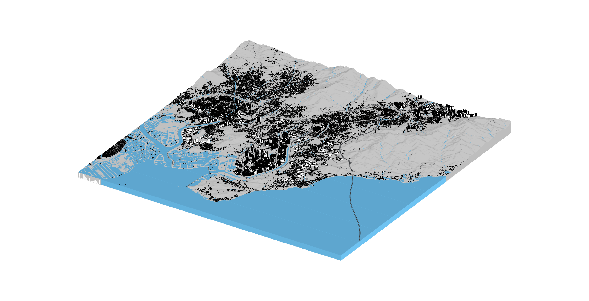
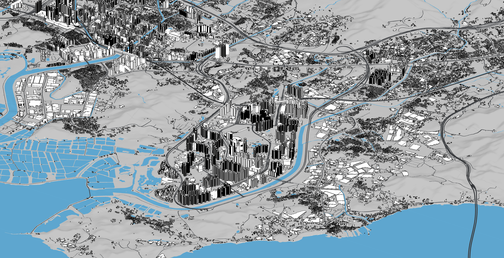

# Final gray model and project previews

[Project overview](../README.md) · [Performance](model-performance.md) · [Validation](validation.md) · [Sources & credits](../SOURCES.md)

The final local set contains one master and **100 tiles** within a **10 × 10 km** site. This page describes their assembly, appearance and checks. Model and preview INI files remain local. The repository publishes images and methods.

## Native presentation captures

The 14 October 2026 views use the local Rhino 8.6 graphical user interface (GUI). The final `Overall_Site_Model.3dm` uses its existing Line drawing style. Native `ViewCaptureToFile` exports have a resolution of **3840 × 1968**. No changes were saved to the source model. These presentation views add no geometry checks or performance samples.

*14 October 2026. Local city view, not the complete site extent.*

*14 October 2026. Transport and terrain presentation view.*

The earlier views below date from **9 October 2026**. The local Rhino 8.6 GUI opened the same final model. The views used existing Line drawing style and native ViewCaptureToFile at **2400 × 1230**. No changes were saved to the source model.

*9 October 2026. Overall view with a manually selected angle.*

*9 October 2026. Detail from the same model and display mode.*

## Model extent and assembly

| Property | Final stage |
|---|---|
| Master | 67,196 model-space objects |
| Tiles | 100 files, each 1,000 × 1,000 m. 67,177 objects in total |
| Master-only objects | 19 objects outside the indexing extent |
| Numbering | Rows A–J north to south. Columns 01–10 west to east |
| Coordinates and scale | Original world coordinates. Full-size meters, 1:1 |
| Absolute model tolerance | 0.001 m |
| File format | Rhino 7. `archive_version = 70` |

The tiles retain their positions in the master coordinate system. Imports at those coordinates assemble the site without manual offsets. `Sliced_Model/D/D05.3dm` means row D, column 05. The grid indexes the existing object assignment. It does not imply a new cut through each building at tile boundaries.

*Generated assembly diagram, not a native Rhino capture.*

The official openNURBS 7.15.0 kernel read all 101 models. Supplementary 8.32.2 reads added precision and terrain-color checks. Native file-opening and display checks used Rhino 8.6. No Rhino 7 desktop test took place. File-format and desktop checks have separate scopes.

## Appearance and display modes

The final color correction changes appearance without changing geometry. It keeps the existing water preview. It adds no Line Drawing overrides to buildings, terrain or foundations.

| Element | Recorded appearance |
|---|---|
| Buildings | 63,097 objects with black attributes |
| Terrain | 84 non-foundation meshes. Object/material RGB 190. Vertex grays from 146 to 198 |
| Foundations | 100 white bases with their original open-mesh state |
| Water | 1,069 existing blue-water overrides |

Black object attributes do not make every displayed face black. Lighting, shading and material rules also affect the view.

*8 October 2026. Native Rhino benchmark capture with isolated, controlled Shaded settings. The benchmark did not change the default Shaded configuration. This performance-test image is separate from the presentation views above.*

The local `Preview_Settings` folder contains `Line_Drawing.ini` and `Blue_Water_Preview.ini`. Assigned water objects use the Blue Water Preview override. The project modes do not require changes to the default Shaded configuration.

The calibrated Line Drawing INI keeps its original name, identity and structure. Five settings changed: vertex colors, ambient light and three light-specular values. The Blue Water Preview INI remains unchanged. Gray terrain material also works in standard Shaded.

### Use the local preview modes

1. Open the local master model in Rhino.
2. Import `Preview_Settings/Line_Drawing.ini` through the Display Modes page in Options.
3. Import `Preview_Settings/Blue_Water_Preview.ini` through the same page.
4. Select the project Line drawing style for the viewport.
5. Use `Zoom Selected` to inspect a building.
6. If you save model edits, use ordinary **Save**.

*Native functional check of D05. Its 1,274 buildings have black attributes, but lighting can make faces gray. The image is not a timing sample.*

## Saved display caches

The final master keeps native display meshes for **64,166 surface objects**. It contains 75,995 meshes, 3,548,417 faces and 4,491,948 vertices. Native standard-Shaded and calibrated-Line checks matched all 64,166 cache signatures.

Ordinary **Save** keeps these caches. **SaveSmall** removes them and changes the conditions for the first display. Cache storage adds file size. [Performance](model-performance.md) reports its measured benefits and costs.

Wheel-zoom sensitivity is an application preference. Model and INI files do not store that preference. The saved cameras and geometry remain separate from it.

## Geometry optimization and its limits

The earlier terrain and road work simplified only planar regions with proof of equivalent surface coverage. It changed **169 meshes and 68,006 regions**. Total mesh faces changed from 12,520,376 to 10,756,752, a 14.086% reduction. Terrain faces changed from 8,831,594 to 7,086,772. Buildings, railway details and rivers kept their geometry.

The proof examined projected coverage, holes, orientation and area across each full region. It also examined 219,065 original seam segments. The symmetric surface-distance bound was **2.57677 × 10⁻⁷ m**, below the 0.001 m processing limit. This measures deviation from source geometry, not real-site survey accuracy. The later color correction adds no geometry error.

## Current verification and public scope

On **9 October 2026**, a hash review matched the master and all 100 tiles to the final validation records. This confirmed the identity of 101 model files. The review did not rerun geometry, display-cache or performance tests. The 14 October captures add presentation views only. Earlier rail and deck counts keep their historical stage in [Validation](validation.md).

The delivery record contains package checks. It does not describe the current working directory as an unchanged copy of that package. No model package is available from this repository. Machine-specific scripts and their dependencies remain local. Shared source materials retain their credits in [Sources & credits](../SOURCES.md).
