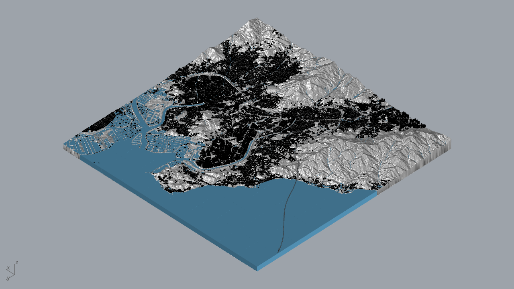
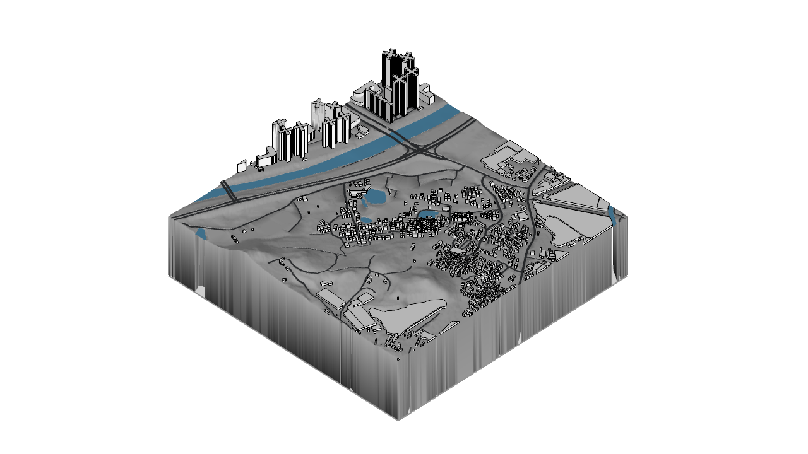

# Model and preview performance

[Back to the project](../README.md) · [Validation](validation.md) · [Image index](../images/README.md)

**Model stage: 8 October 2026. Public snapshot: 14 October 2026.**

The final model combines gray terrain, black building attributes and blue water with saved native display meshes. Terrain and road geometry changed only where full surface-preservation checks passed. The later color correction kept that geometry.

The final comparison showed a faster first Shaded preview, but slower file opening. Opening plus first preview was **5.710%** faster. The 14 October presentation views are separate from this test.

*Native capture from the final 8 October benchmark. Isolated, controlled Shaded settings. The test did not change the default Shaded mode.*

## Scene and assembly

The 10 × 10 km scene uses full-size meters. Its 100 tiles measure 1,000 × 1,000 m each. Rows A–J run north to south. Columns 01–10 run west to east.

The master contains **67,196 objects**. Tiles contain **67,177 object occurrences**. Another **19 objects outside the indexing extent** remain in the master. The existing assignment and original coordinates remain unchanged. The work did not split buildings again at tile boundaries.

[Tile assembly index](../images/tile-assembly-index.png)

The final master and 100 tiles use **Rhino 7 format, archive version 70**. The independent openNURBS 7.15.0 kernel read all 101 files. Supplementary 8.32.2 reads examined double-precision coordinates and full terrain-gray arrays. Native display and timing checks used **Rhino 8.6.24101.5001**. No Rhino 7 desktop test took place.

## Geometry and appearance

Geometry meshes changed from **12,520,376 to 10,756,752 faces**, a **14.086%** reduction. These counts exclude surface display caches. Terrain faces changed from **8,831,594 to 7,086,772**, a **19.757%** reduction. The work removed 588,918 mesh vertices. It accepted 68,006 planar regions across 169 changed meshes. Regions without the full proof kept their geometry.

The full-surface bidirectional distance bound is **2.576769926318507 × 10⁻⁷ m**, below the 0.001 m processing limit. The proof examines full projected coverage, holes, orientation, area and constrained retriangulation. It is not a sampled-point result or a measure of source survey accuracy.

Original double-precision positions, boundaries and topology states remain intact. The checks also examined 219,065 tile seam segments. Buildings, railway details and rivers kept their geometry during the terrain/road and color work. The 100 foundations keep their original open-mesh state.

| Element | Final color record |
|---|---|
| Buildings | 63,097 objects with black attributes |
| Terrain | 84 meshes. Object RGB(190,190,190). Vertex grays from 146 to 198 |
| Foundations | 100 white bases |
| Water | 1,069 original blue-water overrides |

Opaque terrain vertex grays shifted by −50. Their order and differences remain intact. Color correction added **zero geometry error** relative to the validated optimized model.

The D05 Line preview shows one tile. Black outlines and lit faces do not mean every building face is pure black. Original cameras and named views remain unchanged. Project preview modes do not change the default Shaded configuration.

*Native D05 check. Its timing is outside the benchmark below.*

## Saved display meshes

The master keeps **75,995 native display meshes** for **64,166 surface objects**. They contain 3,548,417 faces and 4,491,948 vertices. First-Shaded and calibrated-Line checks matched every saved surface signature after native opening.

The signatures include a universally unique identifier (UUID), mesh cyclic redundancy check (CRC), face/vertex counts and double-precision data. The match establishes cache reuse in those checks. Fewer faces alone do not prove faster interaction.

Ordinary **Save** keeps the caches. **SaveSmall** removes them. Wheel sensitivity is an application preference. Neither the model nor the preview files store a wheel-zoom setting.

## Same-period native comparison

The test used four versions and three independent processes per version: **12 valid runs**. It took place on 8 October 2026 between 04:27:32 and 04:35:40 UTC. Coordinated Universal Time (UTC) identifies the record's time zone.

Every run used the same camera and **1,280 × 720** viewport. Translation aligned the reference's coordinate origin only. The isolated Shaded settings matched across runs. The test did not change the default Shaded mode.

Time uses seconds. Working set uses decimal GB, or 10⁹ bytes, after the first Shaded preview. Each table value is the median of three runs.

| Version | Open | First Shaded | Open + first Shaded | Rotation | Working set (GB) |
|---|---:|---:|---:|---:|---:|
| Earlier reference | 5.94439 | 3.67086 | 9.61525 | 0.2265866 | 2.4436 |
| River-optimized comparison | 8.15626 | 11.87751 | 19.97452 | 0.2879994 | 4.7817 |
| Cache-only comparison | 11.04647 | 8.34037 | 19.42046 | 0.2891744 | 4.6738 |
| Final gray model | 10.84489 | 7.82480 | 18.83398 | 0.2675692 | 4.5348 |

**The total column uses each run's combined time. It is not the sum of the separate Open and First Shaded medians.** First Shaded includes cache preparation, isolated viewport initialization, native drawing/message handling and the first captured preview.

Rotation measures three successive 5° world-Z rotations per run. Each run uses mean full redraw/message-handling time. The table then uses the median of those three run means. The display list was not frozen.

| Final model versus river-optimized comparison | Change |
|---|---:|
| First Shaded time | 34.121% less |
| Rotation time | 7.094% less |
| Open + first preview | 5.710% less |
| Working set | 5.165% less |
| Opening alone | 2.68863 seconds more |

Final rotation remains **18.09% slower than the earlier reference**.

The test hashed input files immediately before opening. This warmed the operating-system (OS) file cache. It did not flush the OS cache. Three varied orders give limited balancing, not a full four-position/predecessor design.

Three runs per version support descriptive medians only. They do not establish statistical significance or a speed guarantee on other machines or views. D05 functional timing remains outside these figures.

## Retained earlier failure

An earlier comparison added three new gray runs. It reused comparison medians from about seven hours earlier. First Shaded changed from 11.3826032 to 7.9132342 seconds. Rotation changed from 0.2729305333 to 0.2844731333 seconds: **4.229% slower**. Its status remains **ACCEPTANCE_FAILED**.

That comparison was not a simultaneous four-version retest. The later 12-run comparison remains separate. It does not delete, merge or relabel the earlier failure. The time gap limits causal interpretation. The records establish neither color alone nor environmental variation alone as the cause.

[Validation](validation.md) and the [structured summary](../evidence/summary.json) retain file identities, package history and source-report hashes. Models, project INI files, working scripts and source datasets remain local.
