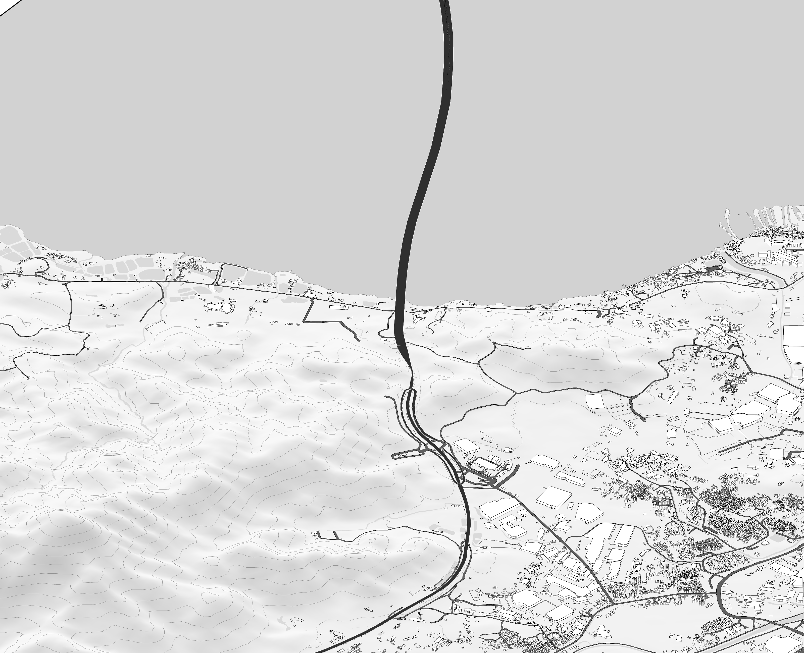
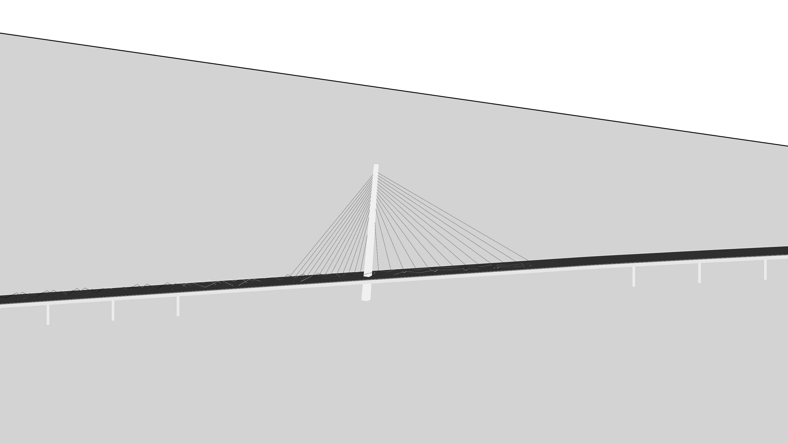
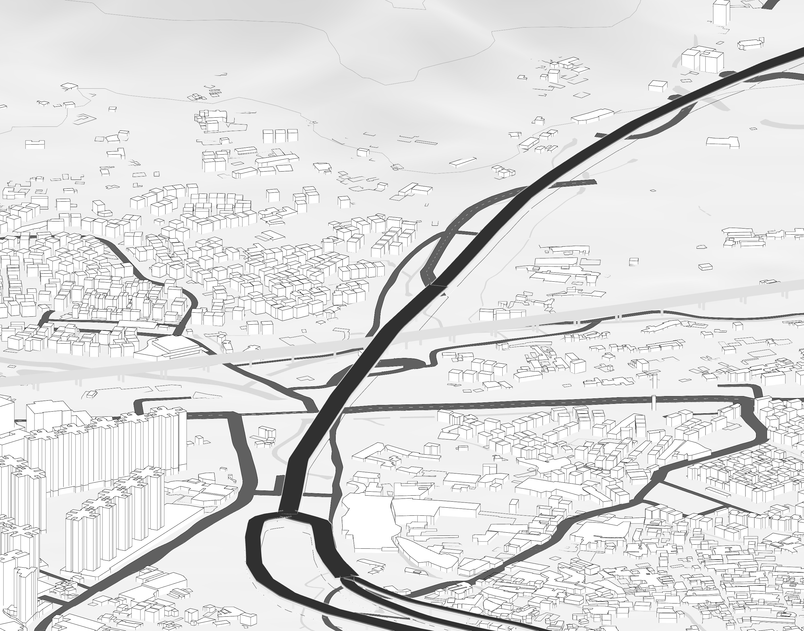
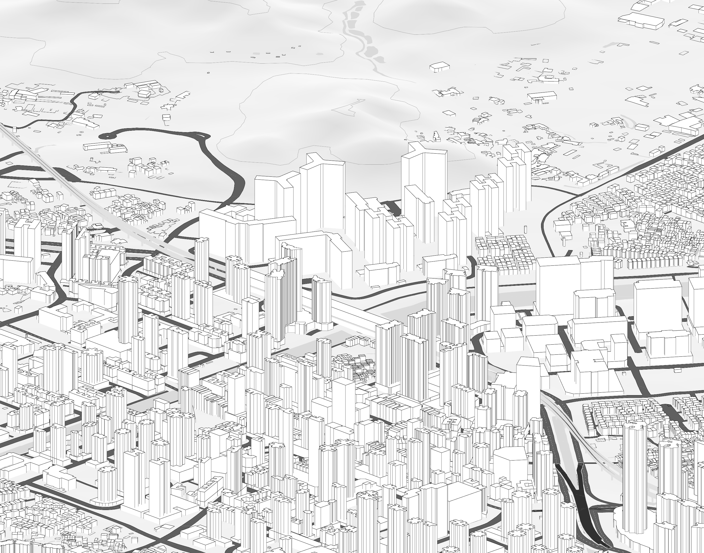
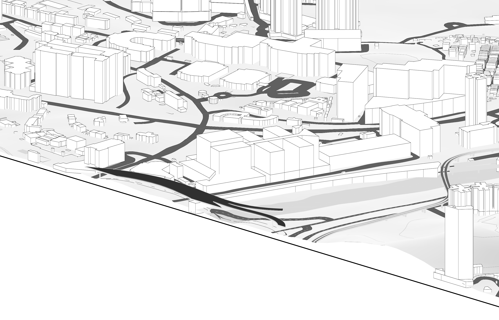

# Terrain, bridges and rail grade separation

[Back to the project](../README.md)

This page records the **24 September 2026 transport stage**. Its crossing counts and native images remain historical evidence. The October model work did not rerun that transport audit. [Model and preview](model-and-preview.md) and [current validation](validation.md) describe the later model, tiles, colors and caches.

The scene combines buildings, road surfaces, coastline, inland water, bridge approaches and rail infrastructure within 10 × 10 km. Source coordinates use EPSG:2326. Local coordinates subtract E=812700 and N=829600. Geometry uses full-size meters and a vertical factor of one. The retained print layout uses 1:10,000.

*14 October 2026. Native Rhino 8.6 GUI presentation export at 3840 × 1968. Line drawing style and ViewCaptureToFile. No changes were saved to the source model. This image adds no transport audit or performance sample.*

## Terrain and coastal context

*Native Rhino capture from site enhancement, before the later rail integration.*

The context includes a 25 m terrain mesh. Coastline geometry combines official mapping and a source that fills a gap. Sea and inland-water surfaces remain separate.

Sea level at Z=0 is a display convention, not an observed tide. Inland water sits just above contextual terrain, not at a measured water level. Local road cuts and the later Tin Shui Wai ground patch are estimates.

*The pylon, deck, cables and piers clarify the study model. Their detailed dimensions are conceptual.*

## Railway integration recorded on 24 September 2026

The stage uses 74 official heavy-rail source pieces. It represents tracks, trackbeds, elevated decks and parapets. Selected light-rail segments include elevated sections, ground transitions and covered railway context. The model adds 445 conceptual support groups with 1,335 column and headcap objects.

The model represents twelve vehicle-deck systems, including the C06 boundary bridge. The other 11 physical corridors include branched profiles. This selected set does not cover every real bridge.

Ground road surfaces remain except beneath the portions that actually rise. Underpasses and unraised parts of the same source route remain intact.

*Local ground, station context and elevated connections.*

*Kong Sham Western Highway. Modeled separation of transport levels.*

*Elevated railway within dense building massing.*

## What was checked

The frozen rail-module report records **21 crossings checked with actual meshes**, with no failures. A separate report records **45 railway-to-ground-road checks**, with no failures. The integrated report also records 86 closed-deck checks.

The method intersects mesh triangles in XY. It computes affine vertical separation at the vertices of overlap polygons. This examines delivered geometry within the model's assumptions. It does not establish surveyed clearance, structural capacity or regulatory compliance. The counts use the structured reports, not the earlier narrative count of 23.

## Known limitations

- **Plan geometry and elevation:** official features support XY positions and identifiers. `DATALEVEL` sets drawing order, not height in meters. Rail and bridge profiles, deck thicknesses, pier positions and many details remain estimates.
- **C06 / Tsing Tin Road:** a 20.5 m illustrative deck avoids a simplified covered structure. A nearby official 15 m spot has no clear deck or ground association. That disagreement remains unresolved. Geometry ends at the study boundary.
- **Tin Shui Wai station:** the simplified solid block is not a surveyed interior. Nearby official spot heights constrain local ground, but it remains an estimate. Rail/block overlap alone does not prove an actual collision.
- **Spans and supports:** a local avoidance span is about 104 m. Some supports are absent within the simplified station context. Further use needs engineering and survey evidence.
- **Dates and detail:** building heights, terrain, mapping and transport references use different dates and resolutions. The image combines them for analysis.

*C06 boundary segment. The image accompanies the unresolved height explanation above.*

[Validation record](validation.md) · [Sources & credits](../SOURCES.md)
