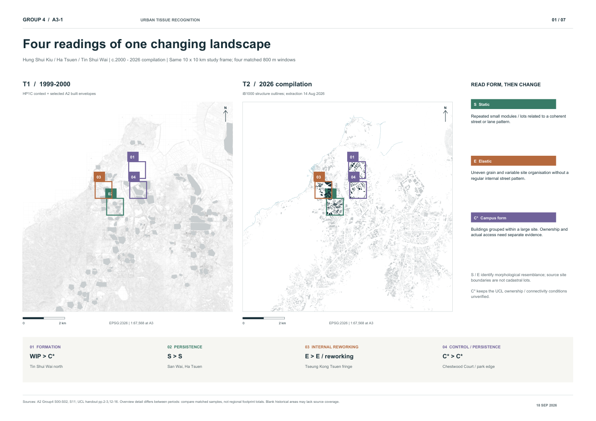

# Urban tissue: formation, persistence and internal change

[Back to the project](../README.md)

The study compares four fixed **800 × 800 m** windows within the 10 × 10 km frame. Historical evidence comes from an HP1C mosaic dated c.1999–2000. The 2026 comparison combines sources from different dates. It is not one observation from one date.

The local output is a seven-page A3 atlas. It contains paired windows, an evidence matrix and source notes.

*Historical maps, current source vectors and analytical annotations have separate roles as evidence.*

## Four comparisons

| Window | Evidence reading | Limit |
|---|---|---|
| 01 — Tin Shui Wai north | Land under construction becomes an organized building group. Campus-form candidate | Ownership and public access remain unconfirmed |
| 02 — San Wai, Ha Tsuen | Repeated building rows persist. Static form with edge changes | Shape persistence does not prove unchanged buildings or ownership |
| 03 — Tseung Kong Tsuen warehouse fringe | Earlier storage and buildings precede the current roofs. Internal change in Elastic form | Not all current storage is new development |
| 04 — Chestwood Court / Tin Shui Wai Park edge | Six main housing forms persist. Another group appears. The park remains open-space context | Stable forms do not prove an unchanged neighborhood or vacant white map areas |

Static and Elastic describe interpreted morphology. A footprint-size threshold does not assign those labels automatically. **C\*** means a Campus-form candidate. The fixed analytical boundaries are not confirmed cadastral parcels.

## Measuring only what the data supports

The study records eight units for specific periods, 11 selected historical axes and 12 evidence points. Current coverage uses the union of building/structure projections within each fixed unit. It counts overlap once.

| Window | T2 unit footprint coverage | Source parts for the area-median statistic |
|---|---:|---:|
| 01 | 26.99% | 15 |
| 02 | 62.57% | 317 |
| 03 | 27.79% | 56 |
| 04 | 19.39% | 13 |

T2 denotes the current comparison period. These percentages describe the selected **units**, not the full 800 m windows or the whole 100 km² site. The counts describe source parts, not independent buildings or households.

No complete, equivalent historical footprint vector layer was available. Thus the study gives no two-period coverage difference or exact total of buildings gained and lost.

## Historical coverage matters

The HP1C mosaic uses 207 official sheet editions: 163 from 1999 and 44 from 2000. Available coverage is about **81.25 km²**. Another 4.08 km² has indexed sheet locations but no available edition from 2000 or earlier. About 14.67 km² lies outside the supplied sheet index. The study did not replace these gaps with later sheets.

Blank historical areas do not prove empty land. Secondary source layers support context only. One apparently historical building replacement nearly matched the current source. The study excluded it as independent historical evidence.

The atlas combines vector analysis, annotations and historical raster scans. [Sources & credits](../SOURCES.md) retains source and date limits.
